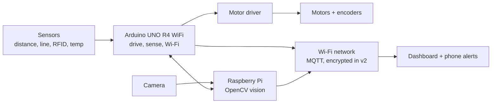

# Secure Autonomous Inspection Rover

An autonomous rover that patrols a mock server-rack aisle, finds overheating or alarming equipment, alerts a phone, and blocks the wireless attacks that worked on its first version.

> **Status:** Stage 0 – Planning. Stage 1 parts ordered Nov 23, 2026; build starts Dec 21. Follow progress in [`/log`](log/).

## The problem

Data centers, warehouses and factories rely on people walking routes to spot failing equipment. Robots are starting to do those patrols — but connected robots can be hijacked. This project builds an inspection rover that **finds faults on its own** and **can't be taken over** with spoofed or replayed commands.

## What it does

1. Drives a set route and avoids obstacles (Arduino UNO R4 WiFi, C++)
2. Knows which "rack" it's at using a floor line and RFID tags
3. Reads equipment temperature and spots red or blinking warning LEDs with a camera (Raspberry Pi, Python, OpenCV)
4. Sends readings to a dashboard and alerts to a phone
5. Rejects spoofed and replayed commands (TLS + message authentication)

## System overview



Full diagram and notes: [`docs/system-diagram.md`](docs/system-diagram.md)

## Roadmap

| Stage | Dates | Goal | Release |
| --- | --- | --- | --- |
| 0 – Planning | Nov 24 – Dec 20, 2026 | Requirements, wiring diagram, test plan, parts ordered | — |
| 1 – Driving robot | Dec 21, 2026 – Jan 17, 2027 | Drives straight with PID, avoids obstacles | `v0.1` |
| 2 – Patrol + sensing | Jan 18 – May 2, 2027 | Follows the aisle, stops at racks, logs temperatures, dashboard | `v0.2` |
| 3 – Camera + alerts | May 10 – Aug 22, 2027 | Detects warning LEDs, phone alerts | `v0.3` |
| 4 – Attack + secure | Aug 23 – Nov 20, 2027 | Attack v1, secure v2, prove it | `v1.0` |
| 5 – Showcase | Nov 21 – Dec 31, 2027 | Demo video, final write-up | — |

## Results

Filled in as each stage is tested. See [`docs/test-plan.md`](docs/test-plan.md) for how each is measured.

| Measure | Target | Actual |
| --- | --- | --- |
| Completes patrol route without help | 10 of 10 laps | — |
| Stops at the correct rack | 95%+ | — |
| Detects planted warning LEDs | 90%+ of 50 trials | — |
| Detection-to-phone-alert time | < 5 s | — |
| Spoofed/replayed commands accepted (v2) | 0 of 20 | — |

## Repository layout

```
firmware/    Arduino UNO R4 WiFi code (C++, PlatformIO), incl. part test programs
vision/      Raspberry Pi camera + OpenCV code (Python)
dashboard/   Dashboard and phone alerts
hardware/    Parts list and wiring diagrams
docs/        Requirements, system diagram, test plan, security docs
log/         Dated build log
```

## Getting started (firmware)

1. Install [VS Code](https://code.visualstudio.com/) and the [PlatformIO](https://platformio.org/) extension.
2. Open the `firmware/` folder in VS Code.
3. Copy `firmware/include/secrets.example.h` to `firmware/include/secrets.h` and fill in your Wi-Fi details. **`secrets.h` is git-ignored — never commit real passwords or keys.**
4. Plug in the Arduino UNO R4 WiFi and upload the `uno_r4_wifi` environment. The onboard LED should blink and the serial monitor (115200 baud) should print a heartbeat.

### Part test programs (Stage 1)

Wire each part using the pin map in [`hardware/wiring/README.md`](hardware/wiring/README.md), then upload its test environment and open the serial monitor:

| Environment | Tests | What you should see |
| --- | --- | --- |
| `test_motors` | TB6612FNG + both motors (wheels off the ground!) | Each wheel ramps up, reverses, then both spin |
| `test_encoders` | LM393 speed sensors | Counts rise ~20 per wheel turn as you turn wheels by hand |
| `test_ultrasonic` | HC-SR04 | Distance in cm tracks your hand |

```bash
pio run -e test_motors -t upload && pio device monitor
```

## Security and ethics

All attack testing in Stage 4 is done **only on my own rover, on my own network**. Testing devices or networks you don't own without permission is illegal. See [`docs/security/threat-model.md`](docs/security/threat-model.md).

## License

[MIT](LICENSE)
