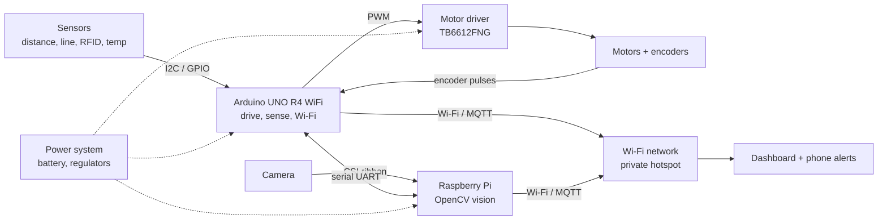

# System diagram

## Parts by stage

| Stage | Adds to the diagram |
| --- | --- |
| 1 | Arduino UNO R4 WiFi, TB6612FNG motor driver, motors + LM393 encoders, HC-SR04, power |
| 2 | GY-87 IMU, line sensors, RFID, IR thermometer, Wi-Fi/MQTT, dashboard |
| 3 | Raspberry Pi, camera, phone alerts |
| 4 | TLS + message authentication on every network link (ESP32-S3 added only if the UNO R4 can't handle it) |
