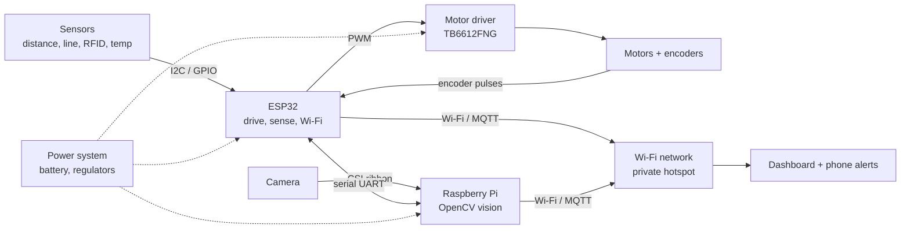

# System diagram

## Parts by stage

| Stage | Adds to the diagram |
| --- | --- |
| 1 | ESP32, motor driver, motors + encoders, distance sensors, IMU, power |
| 2 | Line sensors, RFID, IR thermometer, Wi-Fi/MQTT, dashboard |
| 3 | Raspberry Pi, camera, phone alerts |
| 4 | TLS + message authentication on every network link |
